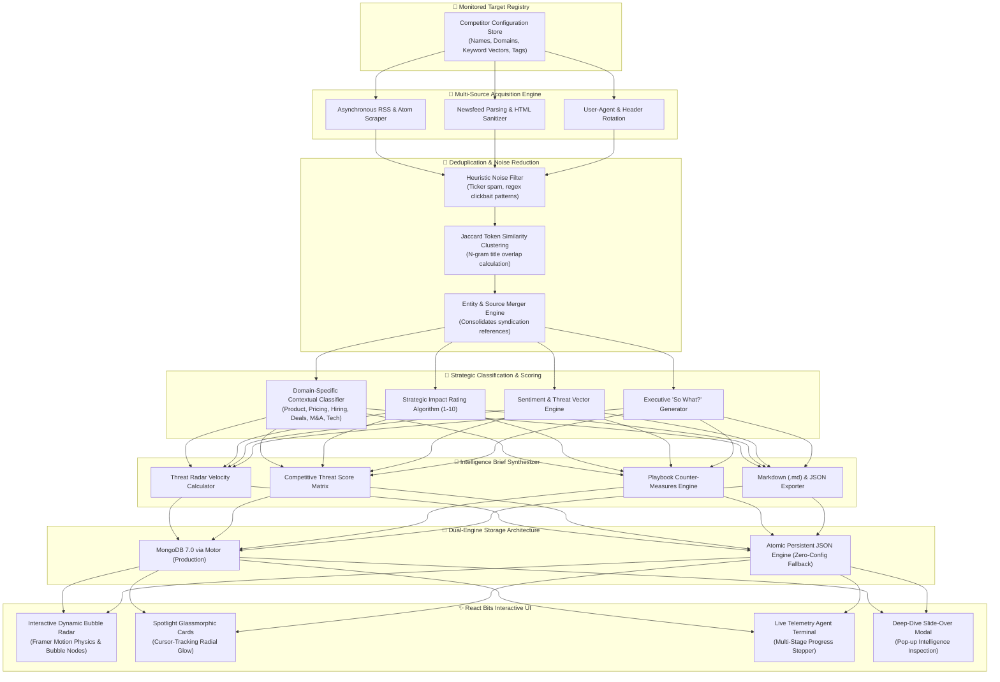

# 👁️ AI Competitor Watch Agent

[](https://frontend-one-psi-97.vercel.app)
[](https://github.com/Sprinkled-cpu/ai-competitor-watch)
[](https://fastapi.tiangolo.com)
[](https://react.dev)
[](https://www.docker.com)

> **Autonomous Enterprise Market Intelligence System** that continuously monitors key rival ecosystems, strips newsroom noise and duplicate syndicated articles, categorizes strategic moves (Product, Pricing, Hiring, Partnerships, Funding, Tech), calculates strategic impact (1–10 scale), and synthesizes concise executive intelligence briefs.

🌐 **Live Production Web App:** [https://frontend-one-psi-97.vercel.app](https://frontend-one-psi-97.vercel.app)  
📦 **Official GitHub Repository:** [https://github.com/Sprinkled-cpu/ai-competitor-watch](https://github.com/Sprinkled-cpu/ai-competitor-watch)

---

## 💡 Section 1: In Plain English (The Layman's Guide)

### What is this project and why does it exist?
Every single day, hundreds of news articles, press releases, and blog posts are published about competing companies in your market. But there is a massive problem:
1. **90% is pure noise:** Daily stock fluctuations (*"Why company X moved 0.5% today"*), clickbait listicles, and automated bot articles.
2. **Endless duplicate copies:** If a rival company launches a new tool, 20 different websites (TechCrunch, Reuters, Bloomberg, Yahoo, Forbes) will write nearly the exact same article.
3. **No strategic context:** A generic news headline doesn't answer the most critical question: *"What does this actually mean for our business?"*

Business leaders, product managers, and founders end up wasting **10 to 15 hours every week** manually scrolling feeds and still missing critical moves.

### The Solution: An AI Market Watch Analyst on Duty 24/7
Think of this project as your personal, automated corporate intelligence analyst. In real time, it does the heavy lifting for you:

* 📡 **1. Gathers Updates Automatically:** It scans newsrooms, company blogs, and press releases for your competitors so you never have to check them manually.
* 🧹 **2. Cleans the Garbage & Merges Duplicates:** It throws away clickbait spam. If 10 outlets cover the same announcement, the agent collapses them into **one clean, verified card** showing all merged sources.
* 🏷️ **3. Tells You What Kind of Move It Is:** It automatically labels each event into **Product Launch**, **Pricing Change**, **Key Hiring/Departure**, **Partnership Deal**, or **Funding Round**.
* ⚡ **4. Rates the Threat Level (1 to 10):** A minor bug fix gets a 2/10; an aggressive price cut or a rival launching an autonomous agent gets a 9/10 ("Code Red").
* 📝 **5. Writes an Executive Brief:** Instead of reading 50 articles, leadership gets a 1-page executive summary with tactical advice on how to respond.

---

## ⚙️ Section 2: Deep Technical Architecture (For Developers & Architects)

### High-Level Architecture Flowchart



### Technical Highlights & Algorithms

#### 1. Jaccard N-Gram Deduplication Engine
Rather than relying on brittle exact-match strings or heavy transformer models for basic deduplication, the engine implements a tokenized Jaccard similarity algorithm:
$$\text{Sim}(A, B) = \frac{|T_A \cap T_B|}{|T_A \cup T_B|}$$
Where $T_A$ and $T_B$ represent cleaned token sets stripped of common stop-words, media suffixes (`- TechCrunch`, `| Reuters`), and punctuation. When $\text{Sim} \ge 0.62$, the stories are identified as syndicated cross-posts and merged into a single primary record with an incremented duplicate counter and combined source citations.

#### 2. Strategic Categorization & Impact Matrix
Every verified update is passed through a multi-pass contextual matcher:
- **Category Weights:** `Product` and `Pricing` carry higher default competitive urgency than routine corporate PR.
- **Threat Lexicon:** Signals triggering terms like *autonomous agent*, *slashes price*, *poaches VP*, or *open weights* increment the base score.
- **Final Normalized Score:** Output on a bounded $[1, 10]$ scale where scores $\ge 8$ trigger a `Critical Threat` alert banner.

#### 3. Dual-Engine Storage (MongoDB + Zero-Config Fallback)
- **Production Mode:** Connects to **MongoDB 7.0** using async `Motor` with connection pooling.
- **Local / Serverless Mode:** If MongoDB is unavailable or when hosted in lightweight serverless environments, it gracefully falls back to an atomic local store without crashing or blocking execution loops.

---

## 🎨 Section 3: React Bits Interactive UI Components

The frontend is constructed using modern **React Bits** component paradigms, delivering a futuristic cyberpunk radar aesthetic:

| Component | Path | Description |
| :--- | :--- | :--- |
| **Dynamic Bubble Radar** | [`InteractiveBubbleRadar.jsx`](frontend/src/components/InteractiveBubbleRadar.jsx) | Interactive floating bubble nodes where diameter represents activity velocity and glowing color represents threat severity. Floating spring physics with hover magnification. |
| **Spotlight Card** | [`SpotlightCard.jsx`](frontend/src/components/reactbits/SpotlightCard.jsx) | Glassmorphic card that tracks cursor coordinates `(x, y)` and casts an ambient radial glow on borders and background. |
| **Shiny Text** | [`ShinyText.jsx`](frontend/src/components/reactbits/ShinyText.jsx) | Animated metallic shimmer typography for headers and brand titles. |
| **Decrypted Text** | [`DecryptedText.jsx`](frontend/src/components/reactbits/DecryptedText.jsx) | Matrix-style cyber decoding text on load and hover. |
| **Deep-Dive Pop-up** | [`UpdateDetailModal.jsx`](frontend/src/components/UpdateDetailModal.jsx) | Interactive modal triggered on card click showing the full event breakdown, impact gauge, and share actions with confetti bursts. |
| **Agent Terminal** | [`LiveAgentTerminal.jsx`](frontend/src/components/LiveAgentTerminal.jsx) | Real-time telemetry log visualizing the 4 stages of the scraping, deduplicating, and synthesizing pipeline. |

---

## 🚀 Section 4: Quickstart Guide

### Option 1: Run Locally (Fastest)

#### Prerequisites
- **Python 3.10+**
- **Node.js 18+** & npm

#### 1. Launch Backend
```bash
# From project root
cd backend
python -m venv ../venv
# Activate venv:
# Windows: ..\venv\Scripts\Activate.ps1
# Mac/Linux: source ../venv/bin/activate

pip install -r requirements.txt
uvicorn main:app --host 0.0.0.0 --port 8000 --reload
```

#### 2. Launch Frontend
In a separate terminal:
```bash
cd frontend
npm install
npm run dev
```
Open **`http://localhost:5173`** in your browser.

---

### Option 2: Run with Docker Compose

To launch the full production stack with MongoDB, the FastAPI backend, and Nginx frontend:

```bash
docker-compose up --build
```

- **Frontend App:** `http://localhost:3000`
- **FastAPI Swagger Docs:** `http://localhost:8000/docs`
- **MongoDB Instance:** `localhost:27017`

---

## 📡 Section 5: REST API Reference

| Method | Endpoint | Description |
| :--- | :--- | :--- |
| `GET` | `/api/competitors` | List all currently monitored competitor targets |
| `POST` | `/api/competitors` | Add a new competitor target to surveillance |
| `DELETE` | `/api/competitors/{id}` | Remove a target and its indexed signals |
| `POST` | `/api/competitors/reset-preset` | Reset to default AI Frontier Labs preset |
| `POST` | `/api/scan` | Trigger live autonomous crawl, deduplication & classification |
| `GET` | `/api/scan/status` | Live scan progress percentage and telemetry log entries |
| `GET` | `/api/updates` | Query filtered updates (by competitor, category, impact score, search) |
| `GET` | `/api/briefs/latest` | Retrieve latest synthesized Executive Intelligence Brief |
| `POST` | `/api/briefs/generate` | Manually re-synthesize an executive brief |
| `GET` | `/api/briefs/{id}/export/markdown` | Download formatted brief as `.md` file |
| `GET` | `/api/analytics` | Statistical distribution of categories, sentiment, and suppressed noise |

---

## 🌿 Section 6: Git & Continuous Deployment

This repository is maintained on GitHub with automated Vercel CI/CD:

```bash
# Push new updates to trigger automatic Vercel production deployment:
git add .
git commit -m "feat: your feature description"
git push origin main
```

- **GitHub Repository:** [https://github.com/Sprinkled-cpu/ai-competitor-watch](https://github.com/Sprinkled-cpu/ai-competitor-watch)
- **Vercel Production:** [https://frontend-one-psi-97.vercel.app](https://frontend-one-psi-97.vercel.app)

---

## 🛡️ License

MIT License. Designed and built for competitive strategy teams, executives, and AI engineering leaders.
