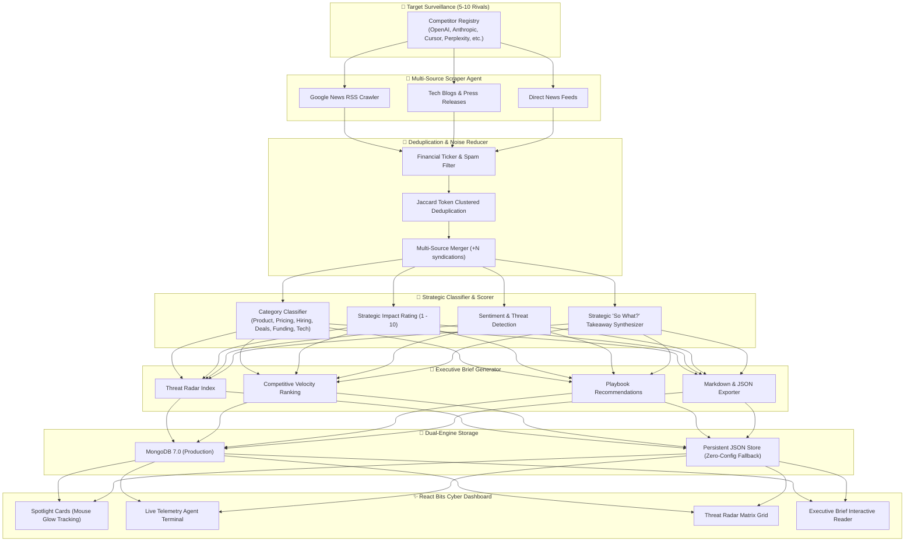

# 👁️ AI Competitor Watch Agent

[](https://frontend-one-psi-97.vercel.app)
[](https://github.com/Sprinkled-cpu/ai-competitor-watch)

> **Autonomous Competitive Intelligence Engine** that continuously monitors 5–10 competitor ecosystems, eliminates noise and duplicate syndicated articles, categorizes strategic moves (Product, Pricing, Hiring, Partnerships, Funding, Tech), calculates threat scores, and synthesizes concise executive intelligence briefs.

🌐 **Live Production Deployment:** [https://frontend-one-psi-97.vercel.app](https://frontend-one-psi-97.vercel.app)  
📦 **GitHub Repository:** [https://github.com/Sprinkled-cpu/ai-competitor-watch](https://github.com/Sprinkled-cpu/ai-competitor-watch)

Built with a high-performance **Python FastAPI** agent pipeline, dual-engine storage (**MongoDB** + zero-config local fallback), and a responsive cyberpunk dashboard powered by **React**, **Tailwind CSS**, and **React Bits** component patterns (Spotlight cards, holographic shiny typography, animated telemetry terminal, and ambient cyber radar).

---

## 🏛️ System Architecture



---

## ✨ Key Features

- **🎯 Precision Rival Surveillance**: Track 5–10 companies simultaneously with customizable search keywords, domains, and sector tags. Includes 1-click presets (*AI Frontier Labs*, *Developer Tools*, etc.).
- **🧹 Noise Filtration & Smart Deduplication**:
  - Automatically filters clickbait, stock ticker auto-bots, and generic listicles.
  - Groups cross-syndicated articles (e.g. Bloomberg vs Reuters vs TechCrunch) into a single primary record with merged source citations.
- **🏷️ Automated Strategic Categorization**:
  - **Product**: Feature launches, API rollouts, reasoning models, agents.
  - **Pricing**: Token price slashes, enterprise tiers, subscription revisions.
  - **Hiring & Leadership**: Key talent migrations, VP/CTO departures, poaching.
  - **Partnership**: Enterprise integrations (e.g., Snowflake, GitHub, Slack).
  - **Funding & M&A**: Venture rounds, acquisitions, sovereign capital.
  - **Research & Tech**: Open-weight weights, architectures, superclusters.
- **⚡ Impact Scoring (1-10) & Executive Takeaways**: Every event receives an urgency score and an executive bullet explaining its strategic consequence on your market position.
- **📑 Autonomous Intelligence Brief**:
  - Generates cross-competitor executive summaries with Markdown export.
  - Computes Threat Radar scores and market momentum index.
  - Provides actionable defensive playbook recommendations.
- **🎨 React Bits Aesthetic**:
  - **Spotlight Cards**: Mouse-following radial glow highlights and glassmorphic backdrop.
  - **Shiny Text**: Holographic iridescent metallic shimmer animations.
  - **Decrypted Text**: Cyber decoding header animation.
  - **Live Agent Terminal**: Real-time step-by-step telemetry stream of the scraper and categorizer.

---

## 🚀 Quick Start Guide

### Option 1: Run Locally (Fastest)

#### Prerequisites
- **Python 3.10+**
- **Node.js 18+** & npm

#### 1. Backend Setup
```bash
# Navigate to project root
cd ai-competitor-watch

# Activate Python virtual environment
# Windows:
.\venv\Scripts\Activate.ps1
# Mac/Linux:
# source venv/bin/activate

# Start FastAPI server (Port 8000)
cd backend
python -m uvicorn main:app --host 0.0.0.0 --port 8000 --reload
```
> *Note: If MongoDB is not running locally, the backend automatically uses `backend/data/storage.json` without failing!*

#### 2. Frontend Setup
In a new terminal window:
```bash
cd ai-competitor-watch/frontend

# Install dependencies (if not already installed)
npm install

# Start Vite dev server (Port 5173)
npm run dev
```

Open [http://localhost:5173](http://localhost:5173) in your browser.

---

### Option 2: Run with Docker Compose

To launch the complete stack with **MongoDB 7.0**, the **FastAPI Backend**, and the **Nginx-served React Frontend**:

```bash
docker-compose up --build
```

- **Frontend Dashboard**: [http://localhost:3000](http://localhost:3000)
- **FastAPI Interactive Docs (Swagger)**: [http://localhost:8000/docs](http://localhost:8000/docs)
- **MongoDB**: `localhost:27017`

---

## 🛠️ API Reference

| Method | Endpoint | Description |
| :--- | :--- | :--- |
| `GET` | `/api/competitors` | List all tracked competitors (5-10 targets) |
| `POST` | `/api/competitors` | Add a new competitor target to surveillance |
| `DELETE` | `/api/competitors/{id}` | Remove competitor and its updates |
| `POST` | `/api/competitors/reset-preset` | Reset to default AI Frontier Labs preset |
| `POST` | `/api/scan` | Trigger live autonomous crawl & classification agent |
| `GET` | `/api/scan/status` | Live scan progress and agent telemetry logs |
| `GET` | `/api/updates` | Query updates (filter by competitor, category, impact) |
| `GET` | `/api/briefs/latest` | Retrieve latest synthesized Executive Intelligence Brief |
| `POST` | `/api/briefs/generate` | Manually re-synthesize an executive brief |
| `GET` | `/api/briefs/{id}/export/markdown` | Export formatted Executive Brief as `.md` file |
| `GET` | `/api/analytics` | Strategic metrics, category velocity, noise suppression |

---

## 🧩 React Bits Components

- `src/components/reactbits/SpotlightCard.jsx`: Interactive hover card with custom CSS variables tracking cursor `(x, y)` to cast a radial cyber glow.
- `src/components/reactbits/ShinyText.jsx`: Animated background-position gradient shimmer text.
- `src/components/reactbits/DecryptedText.jsx`: Progressive character decrypting effect.
- `src/components/reactbits/CyberGrid.jsx`: Ambient glowing backdrop with blur orbs.

---

## 🌿 Git & GitHub Repository Setup

To push this project to your GitHub account:

```bash
# 1. Initialize Git repository
git init

# 2. Stage all files
git add .

# 3. Create initial commit
git commit -m "feat: AI Competitor Watch Agent with React Bits dashboard, multi-source scraper, and Docker"

# 4. Link your GitHub remote
git branch -M main
git remote add origin https://github.com/<your-username>/ai-competitor-watch.git

# 5. Push to GitHub
git push -u origin main
```

---

## 🛡️ License

MIT License. Built for competitive strategy teams and AI leaders.
